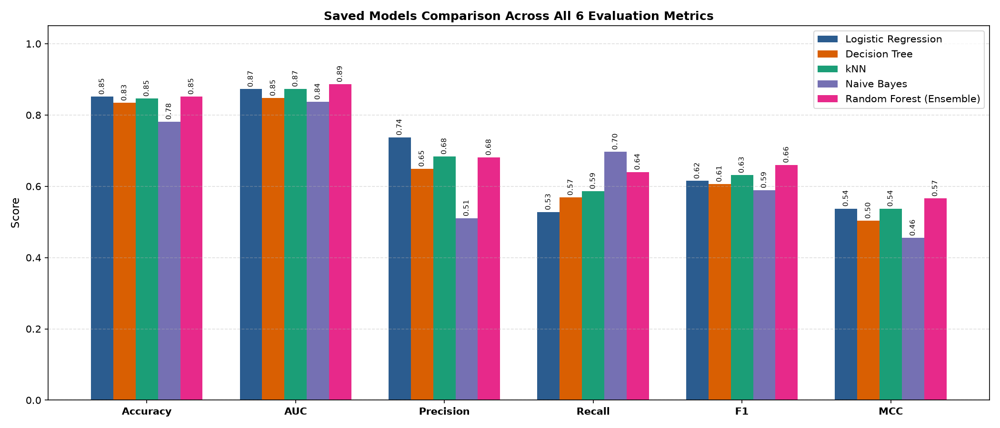
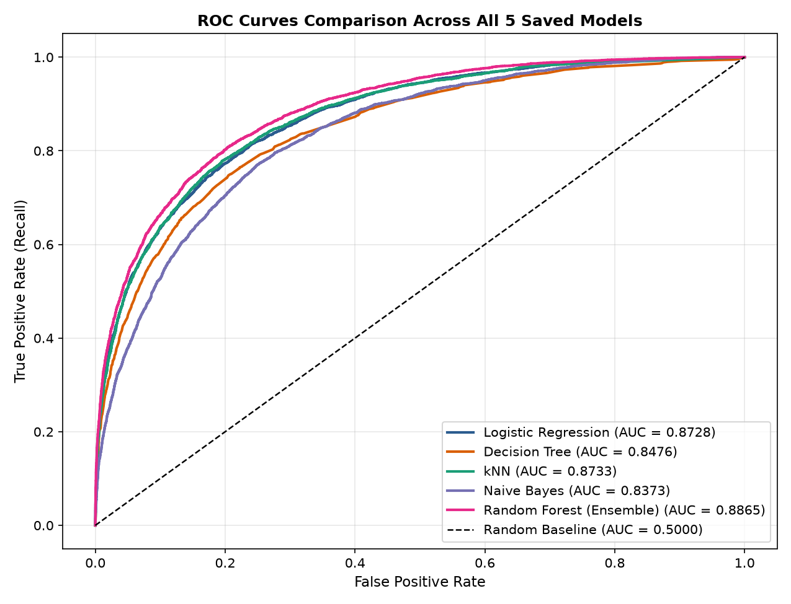
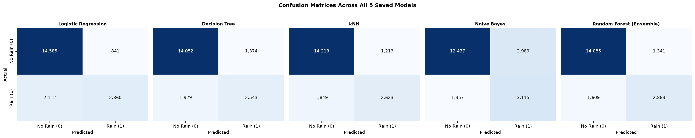
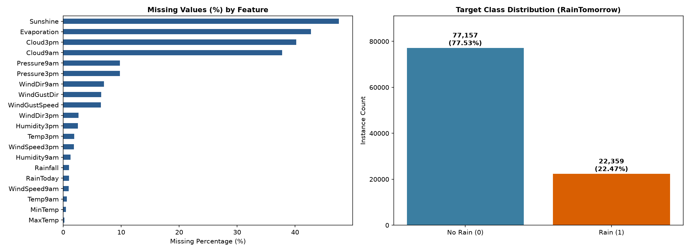
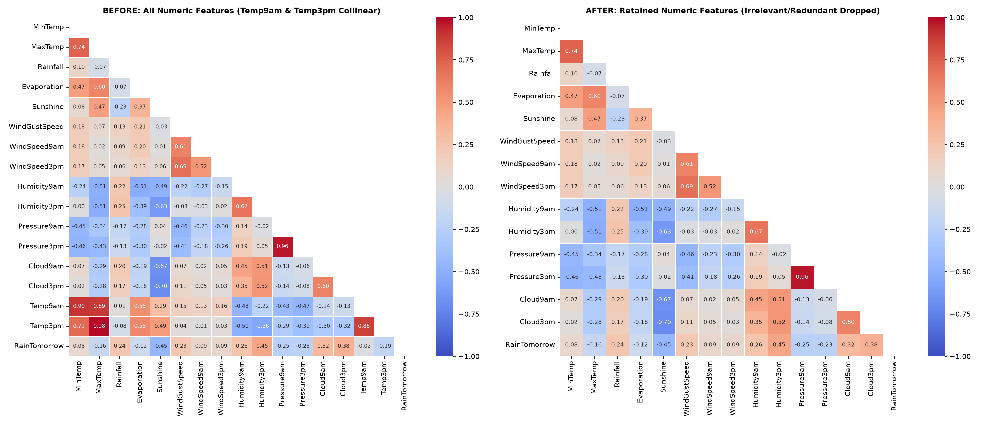
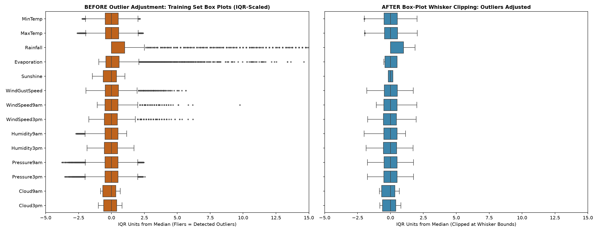
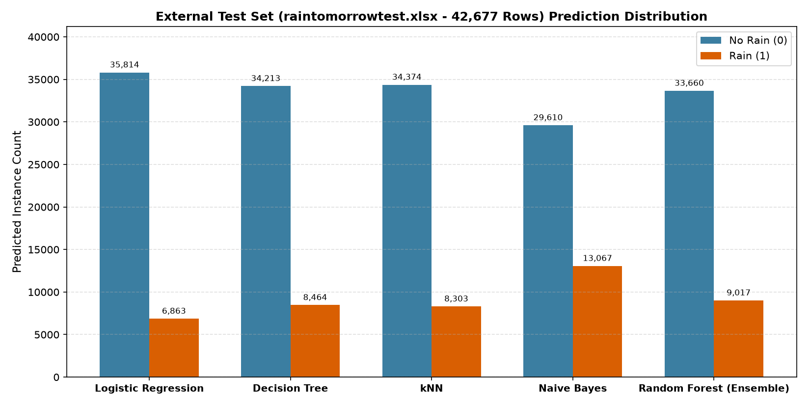

# RainTomorrow Classification — Machine Learning Assignment-2

## a. Problem Statement

Given daily meteorological observations across 49 weather stations, the objective is to build a supervised binary classification pipeline to predict whether it will rain tomorrow: `RainTomorrow` (`0` = No Rain, `1` = Rain). Because meteorological sensor data contains heavy missingness, skewed extreme rainfall events, and class imbalance (~22.47% positive rain days), five classification models (**Logistic Regression**, **Decision Tree**, **kNN**, **Naive Bayes**, and **Random Forest (Ensemble)**) are trained and evaluated across six metrics (`Accuracy`, `AUC`, `Precision`, `Recall`, `F1`, and `MCC`), followed by predictions on an unlabeled external dataset (`raintomorrowtest.xlsx`).

## b. Dataset Description

* **Dataset & Dimensions:** Daily weather observations dataset (`99,516` raw rows × `23` columns; `99,486` rows × `20` columns after removing `30` duplicate rows and `3` redundant/identifier columns: `row ID`, `Temp9am`, `Temp3pm`).
* **Target Variable & Class Distribution:** `RainTomorrow` (`0` = No Rain: `77,129` instances / `77.53%`; `1` = Rain: `22,357` instances / `22.47%`).
* **Retained Features (19 total → 113 after One-Hot Encoding):**
  * **14 Numeric Features:** `MinTemp`, `MaxTemp`, `Rainfall`, `Evaporation`, `Sunshine`, `WindGustSpeed`, `WindSpeed9am`, `WindSpeed3pm`, `Humidity9am`, `Humidity3pm`, `Pressure9am`, `Pressure3pm`, `Cloud9am`, `Cloud3pm`.
  * **5 Categorical Features:** `Location` (49 stations), `WindGustDir` (16 directions), `WindDir9am` (16 directions), `WindDir3pm` (16 directions), `RainToday` (`Yes`/`No`).
* **Missing Value Profile:** Handled missing values across features including `Sunshine` (`47.55%`), `Evaporation` (`42.74%`), `Cloud3pm` (`40.20%`), `Cloud9am` (`37.75%`), `Pressure9am` (`9.80%`), `Pressure3pm` (`9.78%`), and wind/humidity/temperature fields via median imputation (numeric) and most-frequent imputation (categorical), fitted strictly on the training set.
* **Data Splitting & Preprocessing (Leakage-Free):**
  * `80:20` stratified train-test split with fixed random seed (`Train`: `79,588` rows, `22.47%` positive; `Test`: `19,898` rows, `22.47%` positive, saved as `test_data.csv`).
  * `1.5 × IQR` box-plot outlier clipping fitted on training data (e.g., `Rainfall` clipped to `[0.00, 2.00]`, capping `14,166` outliers; `WindGustSpeed` clipped to `[6.00, 72.00]`, capping `1,660` outliers), followed by `StandardScaler` normalization and `OneHotEncoder`.

  **Reason for choosing dataset:** 
  **1. Samples per class:** Number of samples per class is more than threshold of 1000 classes per sample.
  **2. Total rows:** Total number of rows 99516 exceeds the specified threshold
  **3. Total Number of Classes:** There are totally 2 classes, meeting the specified threshold
  **4. Number of features:** Number of features is 23, more than the specified 12 features.
  **5. Class Imbalance:** There is signficant class imbalance of 78% and 22%.

## c. GitHub Repository Link

* **GitHub Repository:** https://github.com/2026ct05141-aiml/ML_5_Classification_Models

## d. Models Used
1. Logistic Regression
2. Decision Tree Classifier
3. Random Forest Classifier
4. KNN
5. Naive Bayes Classifier

### Evaluation Metrics Comparison Table

| ML Model Name | Accuracy | AUC | Precision | Recall | F1 | MCC |
| :--- | :---: | :---: | :---: | :---: | :---: | :---: |
| Logistic Regression | 0.8516 | 0.8728 | 0.7373 | 0.5277 | 0.6151 | 0.5376 |
| Decision Tree | 0.8340 | 0.8476 | 0.6492 | 0.5686 | 0.6063 | 0.5035 |
| kNN | 0.8461 | 0.8733 | 0.6838 | 0.5865 | 0.6314 | 0.5374 |
| Naive Bayes | 0.7816 | 0.8373 | 0.5103 | 0.6966 | 0.5891 | 0.4551 |
| Random Forest (Ensemble) | 0.8517 | 0.8865 | 0.6810 | 0.6402 | 0.6600 | 0.5657 |

### Visualization of Metrics (Graph Representation)

### Model Performance Observations

| ML Model Name | Observation about model performance |
| :--- | :--- |
| Logistic Regression | Highest Precision (0.7373) and second-best Accuracy (0.8516) at threshold 0.50, keeping false-positive rain alerts lowest (16.08% predicted rain on external data). However, additive linear boundaries miss non-linear meteorological interactions, yielding the lowest Recall (0.5277). |
| Decision Tree | Lowest Accuracy (0.8340) and second-lowest AUC (0.8476) and MCC (0.5035) at threshold 0.42. Single-tree axis-aligned splits struggle to generalize across 113 one-hot-encoded station and wind-direction features without overfitting, trailing Random Forest by 0.0622 in MCC. |
| kNN | Second-best F1 (0.6314) and AUC (0.8733), matching Logistic Regression on MCC (0.5374 vs 0.5376) at threshold 0.40. Outlier capping (14,166 Rainfall values clipped at 2.00) and standard scaling stabilize local distances, though high dimensionality (113 features) caps Recall at 0.5865. |
| Naive Bayes | Highest Recall (0.6966) at threshold 0.38, capturing nearly 70% of actual rain events, but suffers from the lowest Accuracy (0.7816), Precision (0.5103), and MCC (0.4551). Feature independence assumptions break down across correlated humidity, cloud, and pressure variables, over-predicting rain (30.62% on external data). |
| Random Forest (Ensemble) | Best overall model across Accuracy (0.8517), AUC (0.8865), F1 (0.6600), and MCC (0.5657) at threshold 0.38. Delivers a +0.1125 Recall gain over Logistic Regression (0.6402 vs 0.5277) while keeping Precision competitive (0.6810), and predicts 21.13% rain on external data—closest to the ground-truth 22.47% training prevalence. |
| Overall Winner for your dataset? | **Random Forest (Ensemble)** is the overall winner for this dataset, achieving the highest **MCC (0.5657)**, **AUC (0.8865)**, **F1 (0.6600)**, and **Accuracy (0.8517)** while maintaining well-calibrated rain predictions (21.13%) on unseen external data. |